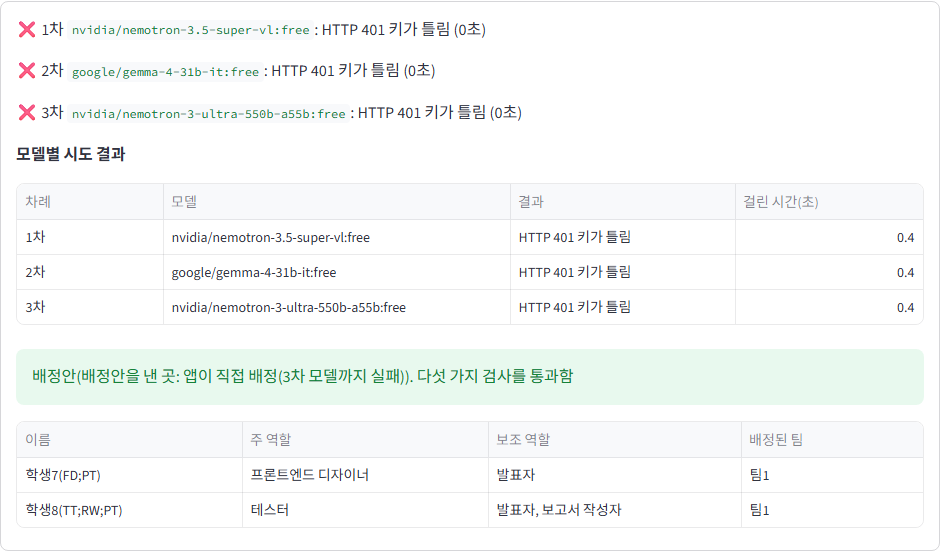
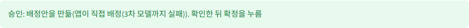
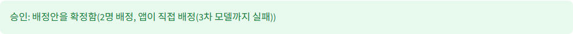
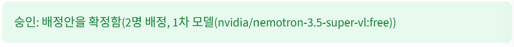
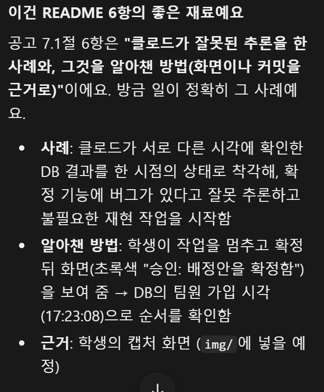
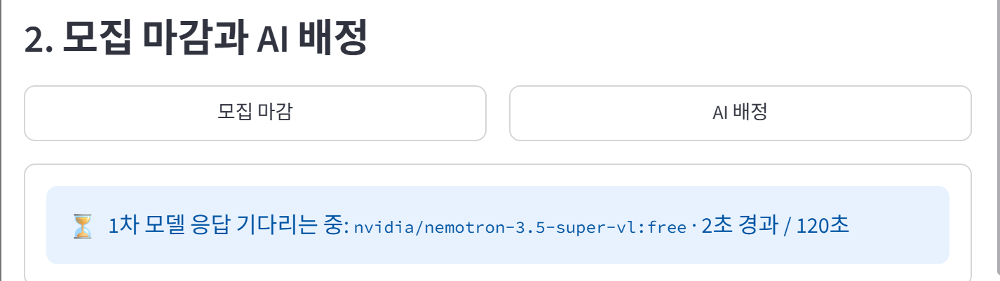

# 팀 프로젝트 팀 편성 웹 앱

데이터과학 미니프로젝트 중간 과제로 만든 앱이다. 학생이 스스로 팀에 지원하고 팀원이 투표로 받아들이며, 모집을 마감한 뒤 남은 학생은 AI가 배정하고 앱이 그 배정안을 규칙으로 검사한다. 공고에서 허용한 대로 클로드 코드와 함께 만들었고, 나는 요구사항과 해결 방법을 정하고 단계마다 브라우저에서 직접 확인하며 진행했다.

## 1. 배포 주소

https://teamformation-s3y2ung.streamlit.app

- Streamlit Community Cloud에 배포했다. 저장소가 비공개라서 처음에는 Streamlit이 저장소를 찾지 못했는데, Workspace settings의 Linked accounts에서 Private access를 연결한 뒤 배포할 수 있었다.
- 배포한 앱의 공개 범위를 "This app is public and searchable"로 바꾸고, 로그인하지 않은 브라우저로 열어 로그인 화면이 보이는 것을 확인했다.
- 관리자 학번은 `admin`이고, 비밀번호는 e-class 제출 칸에만 적었다.

## 2. PRD와 구현 계획의 위치

| 문서 | 위치 |
|---|---|
| PRD(제품 기획서) | [docs/PRD.md](docs/PRD.md) |
| 구현 계획(6단계) | [docs/구현 계획.md](docs/구현%20계획.md) |
| 테이블을 만드는 SQL | [schema.sql](schema.sql) |

- 4장에서 배운 대로 한 번에 다 만들지 않고 6단계로 나눴다. 단계를 마칠 때마다 내가 브라우저에서 확인한 뒤 커밋했다(`git log`의 "1단계: 뼈대와 로그인"부터 "5단계 준비"까지).

## 3. 고른 해결 방법

공고 3장의 기능 8개를 모두 어려운 해결로 골랐다. 쉬운 해결은 0점이거나 일부 점수만 받고, 특히 필수 포함 역할 기능은 쉬운 해결(1.5점)과 어려운 해결(7점)의 차이가 커서다.

| 기능 | 고른 해결 | 구현한 내용 |
|---|---|---|
| 다른 사람의 변경 보기 | 어려운 해결 | 학생 화면과 관리자 화면의 팀 목록, 지원, 투표 영역을 `st.fragment(run_every=3)`으로 감싸 3초마다 바뀐 부분만 다시 그린다. 새로 고침 단추는 두지 않았다. 브라우저 탭 두 개로 한쪽에서 지원하면 다른 쪽에 3초 안에 나타나는 것을 확인했다. |
| 필수 포함 역할을 지킬 수 없는 팀 | 어려운 해결 | 지원자가 들어간 뒤 남는 자리 수가 아직 채우지 못한 필수 포함 역할 수보다 적으면 "막힘: 필수 포함 역할을 맡을 학생의 자리가 모자람"으로 막는다. 한 학생이 기획자와 웹 프로그래머를 둘 다 할 수 있어도 하나로만 센다(`teamapp/rules.py`). 연습용 어려움 시나리오 11단계에서 학생14의 지원이 막히는 것을 직접 확인했다. |
| 같은 팀에 대기 중인 지원이 여럿 | 어려운 해결 | 팀원 모두가 찬성한 순간 정원, 주 역할 중복, 필수 포함 역할 자리를 다시 검사하고, 어기면 "거절: 승인 직전 검사에서 …"로 거절한다. 처리 순서는 투표가 끝난 순서이고, 지원한 뒤에 팀원이 된 학생도 투표해야 한다. 어려움 시나리오 8단계에서 학생2, 학생8, 학생5 순으로 찬성해 마지막에 거절되는 것을 직접 확인했다. |
| 마지막 자리에 두 명이 동시에 들어감 | 어려운 해결 | `tf_members`의 기본 키 `(team_id, slot_no)`와 `student_id` 유일성 제약으로 먼저 도착한 학생만 기록한다. 같은 팀에 대한 지원, 투표는 팀 행을 잠가(`for update`) 차례로 처리한다([schema.sql](schema.sql)). |
| AI 응답이 늦을 때 | 어려운 해결 | 요청을 별도 스레드로 보내고, 모델 하나를 부른 때부터 응답을 다 받을 때까지 전체 120초를 재서 넘으면 기다리지 않고 다음 모델로 넘어간다(`teamapp/ai.py`). |
| 3차 모델까지 실패 | 어려운 해결 | 팀이 없는 학생을 한 명씩 팀에 넣어 보다가 규칙을 어기면 되돌아가는 방식(백트래킹)으로, 다섯 가지 검사를 모두 통과하는 배정을 모든 경우를 따져 찾는다(`teamapp/solver.py`). 배정이 아예 없으면 AI를 부르지 않고 이유를 보여 준다. |
| AI 대기 중 화면 | 어려운 해결 | `assign_status` 안에 "⏳ 1차 모델 응답 기다리는 중: `모델 이름` · 2초 경과 / 120초"처럼 몇 차 모델을 기다리는지와 경과 시간을 1초마다 보여 주고, 끝난 모델은 결과(성공, 시간 초과, HTTP 오류, 검사 불통과)를 한 줄씩 남긴다. |
| DB(Supabase)가 일시정지되지 않게 | 어려운 해결 | 깃허브 Actions의 예약 실행([.github/workflows/keepalive.yml](.github/workflows/keepalive.yml))이 매일 한 번 `scripts/keepalive.py`로 DB에 질의한다. 예약 시각은 한국 시각 09:00인데 깃허브가 늦게 실행하기도 한다(11/1에는 13:55에 실행됐다). DB 주소는 저장소 Secrets에 두었다. 10/31에 손으로 한 번, 11/1에 예약으로 한 번 실행되어 모두 성공했다. |

## 4. 쓴 모델 3개

| 차례 | 모델 |
|---|---|
| 1차 | `nvidia/nemotron-3.5-super-vl:free` |
| 2차 | `google/gemma-4-31b-it:free` |
| 3차 | `nvidia/nemotron-3-ultra-550b-a55b:free` |

- 2026-10-31 오픈라우터 모델 목록에서 이름이 `:free`로 끝나는 텍스트 모델 가운데 골랐다. 공고 7.1절 예시의 `nemotron-3-super-120b-a12b:free`는 6장 노트에 따르면 이미 무료 목록에서 빠져서 쓰지 않았다. 무료 모델로 자동 연결하는 라우터(`openrouter/free`)도 쓰지 않았다.
- 1차와 2차를 다른 회사 모델로 둔 이유는, 한 회사의 제공자가 막혀도 다음 모델이 응답할 수 있어서다.
- 빈 응답을 줄이려고 요청에 `reasoning: {"effort": "low"}`를 주고 `max_tokens`를 8000으로 두었다.
- 배포한 앱에서 연습용 쉬움 시나리오 6단계를 했을 때 1차 모델이 11초 만에 규칙을 지키는 배정안을 냈다.

## 5. 오픈라우터 AI 모델 호출 실패 사례

### 사례: 1차, 2차, 3차 모델이 모두 HTTP 401로 실패하고 앱이 직접 배정함

내가 앱을 써 본 동안에는 무료 모델이 자연스럽게 실패한 적이 없었다(배포한 앱에서도 1차 모델이 11초 만에 성공했다). 그래서 "3차 모델까지 실패하면 앱이 스스로 배정한다"는 처리가 실제로 동작하는지 보려고, 실패를 일부러 만들어 확인했다. 아래는 꾸민 화면이 아니라, 일부러 틀린 키를 준 상태에서 앱이 실제로 오픈라우터를 불렀다가 거절당한 결과다.

- 조건: 내 컴퓨터에서 앱을 실행할 때만 `OPENROUTER_API_KEY`를 틀린 값으로 주었다. `.env`와 배포한 앱의 키는 바꾸지 않았다. 틀린 키는 오픈라우터가 바로 거절하므로 내 계정의 하루 호출 횟수도 쓰지 않는다.
- 시나리오: 연습용 쉬움 시나리오 1~5단계를 한 뒤, 6단계(관리자가 마감하고 배정, 확정)를 했다.

| 차례 | 모델 | 결과 | 걸린 시간 |
|---|---|---|---|
| 1차 | `nvidia/nemotron-3.5-super-vl:free` | HTTP 401 키가 틀림 | 0.4초 |
| 2차 | `google/gemma-4-31b-it:free` | HTTP 401 키가 틀림 | 0.4초 |
| 3차 | `nvidia/nemotron-3-ultra-550b-a55b:free` | HTTP 401 키가 틀림 | 0.4초 |
| 그 뒤 | 앱이 직접 배정 | 학생7, 학생8을 팀1에 넣는 배정안이 다섯 가지 검사를 통과함 | |

- 화면
  - AI 배정 진행 안내(`assign_status`): 모델마다 실패 이유가 한 줄씩 남고, 배정안을 낸 곳이 "앱이 직접 배정(3차 모델까지 실패)"으로 나온다 ([img/case5-ai-failed-app-assigned.png](img/case5-ai-failed-app-assigned.png))
  - 결과 안내: "승인: 배정안을 만듦(앱이 직접 배정(3차 모델까지 실패))" ([img/case5-result.png](img/case5-result.png))
  - 확정 뒤 결과 안내: "승인: 배정안을 확정함(2명 배정, 앱이 직접 배정(3차 모델까지 실패))" ([img/case5-confirmed.png](img/case5-confirmed.png))
- 기록: 모델마다의 시도 결과는 DB의 `tf_ai_logs` 테이블에도 남는다.

### 확인한 것과 확인하지 못한 것

- 실패한 모델을 건너뛰고 다음 모델로 넘어가는 것, 3차까지 실패하면 앱이 규칙을 지키는 배정을 스스로 찾는 것은 위 화면으로 확인했다.
- 모델이 120초 안에 응답하지 않는 경우는 실제 무료 모델로 일으킬 수 없어서, 일부러 늦게 답하는 가짜 모델로 자동 시험만 했다(`tests/test_assign.py`의 `test_slow_model_is_cut_at_total_timeout`). 실제 오픈라우터 응답으로는 확인하지 못했다.

## 6. 클로드가 잘못된 추론이나 답변을 한 사례

### 사례: 정상인 확정 기능에 버그가 있다고 잘못 추론함

배포한 앱에서 연습용 쉬움 시나리오 6단계(마감, AI 배정, 확정)를 내가 직접 했다. 그 뒤 클로드가 DB를 확인하고 이렇게 보고했다.

> 즉 배정안은 사라졌는데 팀에는 들어가지 않은 상태예요.

클로드는 이것을 확정 기능의 버그라고 보고, 원인을 찾겠다며 자동 브라우저로 같은 상황을 재현하는 작업을 시작했다.

### 실제로 일어난 일

클로드는 DB를 두 번에 나눠 확인했는데, 그 사이에 내가 확정 단추를 눌렀다.

| 시각(한국) | 일 |
|---|---|
| 17:21:21 | 내가 AI 배정을 누름. 1차 모델이 11초 만에 배정안을 냄 |
| 17:23 전 | 클로드의 첫 번째 확인(팀 목록): 학생7, 학생8이 아직 팀이 없음 |
| 17:23:08 | 내가 배정안 확정을 누름. 학생7은 팀1, 학생8은 팀2에 들어가고 배정안은 지워짐 |
| 17:23:08 뒤 | 클로드의 두 번째 확인(배정안): 배정안이 없음 |

클로드는 서로 다른 시각에 확인한 두 결과를 같은 순간의 상태로 착각해서, "배정안은 지워졌는데 팀에는 안 들어갔다"는 있지도 않은 상태를 만들어 냈다.

### 알아챈 방법

1. 클로드가 재현 작업을 시작했을 때 나는 이미 확정까지 끝냈다고 생각해서 작업을 멈추게 했다.
2. 확정 직후에 찍어 둔 화면을 보여 줬다. 화면에는 초록색으로 "승인: 배정안을 확정함(2명 배정, 1차 모델(…))"이 나와 있었다([img/case6-confirm-approved.png](img/case6-confirm-approved.png)).
3. 클로드가 DB를 다시 확인하자 학생7과 학생8이 팀에 들어가 있었고, 들어간 시각이 17:23:08로 기록되어 있었다. 이 시각으로 두 번의 확인 사이에 내가 확정을 눌렀다는 순서가 드러났다.
4. 클로드도 자기 추론이 틀렸다고 인정하고 그 경위를 설명했다([img/case6-claude-explanation.png](img/case6-claude-explanation.png)).

### 배운 점

- 클로드가 "버그가 있다"고 해도 그것은 확인이 아니다. 내가 본 화면과 기록의 시각을 맞춰 봐야 한다.
- 상태를 여러 번 나눠 확인할 때는 그 사이에 누가 무엇을 바꿨는지 따져야 한다.
- 내가 작업을 멈추지 않았다면 클로드는 정상 코드를 고치려 했을 것이고, 재현에 AI 호출 횟수도 썼을 것이다.

## 7. 앱에서 발견한 문제점이나 개선 필요 사항

### 문제: 배포한 앱에서 AI 호출 기록의 이름이 한국 시각이 아니라 UTC 시각으로 남음

- 발견한 단계: 배포한 앱에서 연습용 쉬움 시나리오 6단계(관리자가 마감하고 배정, 확정)
- 무슨 일: 나는 한국 시각 17:21에 AI 배정을 눌렀다. 이때 찍은 화면은 1차 모델의 응답을 기다리는 모습이고, 파일 이름의 시각이 17:21:15이다([img/case7-ai-waiting-1721.png](img/case7-ai-waiting-1721.png)). 그런데 DB의 `tf_ai_logs`에 남은 이 호출의 기록 이름(`run_id`)은 `20261031-082110`, 즉 08:21이었다. 같은 기록의 `created_at`을 한국 시각으로 바꾸면 17:21:21이어서, 기록 이름만 9시간 이르게 남은 것이다.

  

  | 열 | 값 |
  |---|---|
  | `run_id` | `20261031-082110` |
  | `created_at`(한국 시각으로 바꿈) | 2026-10-31 17:21:21 |
  | `model` | `nvidia/nemotron-3.5-super-vl:free` |
  | `outcome` | 성공 |

- 원인: 기록 이름을 `time.strftime`으로 만들었는데, 이 함수는 앱이 도는 컴퓨터의 시계를 따른다. 내 컴퓨터에서는 한국 시각이라 문제가 없었지만, Streamlit 배포 서버의 시계는 UTC다. 공고 4.4절이 "배포 서버의 시각은 세계 표준시(UTC)임. 화면에 시각을 보여 주려면 한국 시각으로 바꿔서 보여 줘야 함"이라고 한 바로 그 문제다.
- 영향: 기록 이름은 화면에 나오지 않고 채점 결과에도 영향이 없다. 하지만 AI 호출 기록을 시각으로 찾을 때 9시간 차이 때문에 엉뚱한 기록을 볼 수 있다.
- 고친 것: 커밋 `f2c960b`에서 `datetime.now(KST)`로 바꿔, 서버 시계와 관계없이 한국 시각으로 남게 했다. 서버 시계를 UTC로 두고 실행해 보니, 고치기 전 방식은 13:51, 고친 방식은 22:51(그때의 한국 시각)을 냈다.
- 남은 개선점: DB의 다른 시각(`created_at`, `joined_at` 등)은 시간대 정보가 함께 저장되는 `timestamptz`라 문제가 없다. 다만 앞으로 화면에 시각을 보여 주는 기능을 더한다면 같은 방식으로 한국 시각으로 바꿔 보여 줘야 한다.
